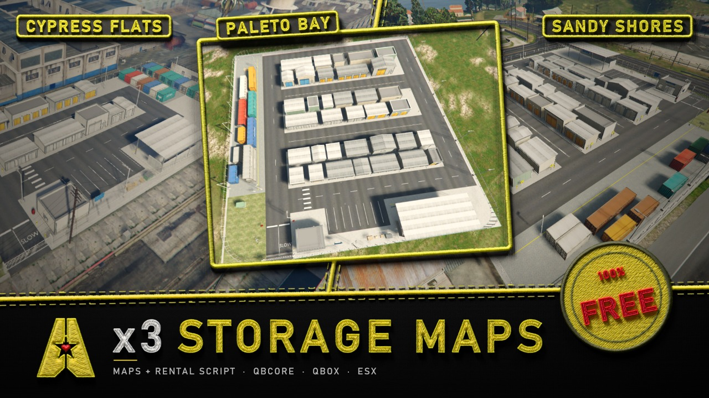
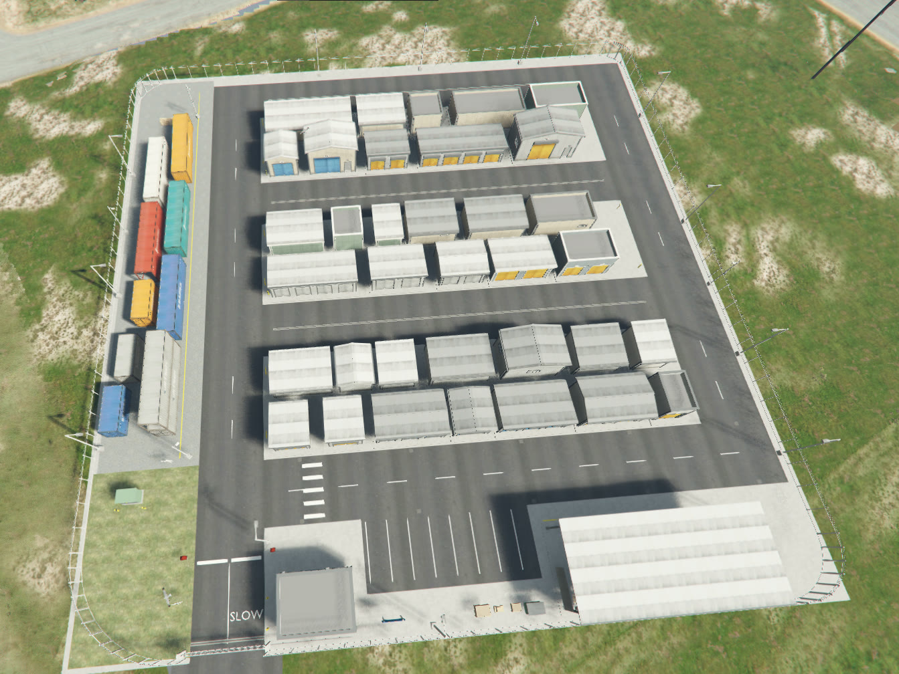
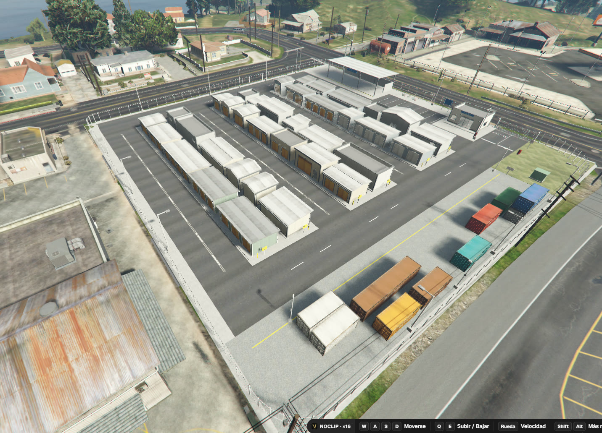
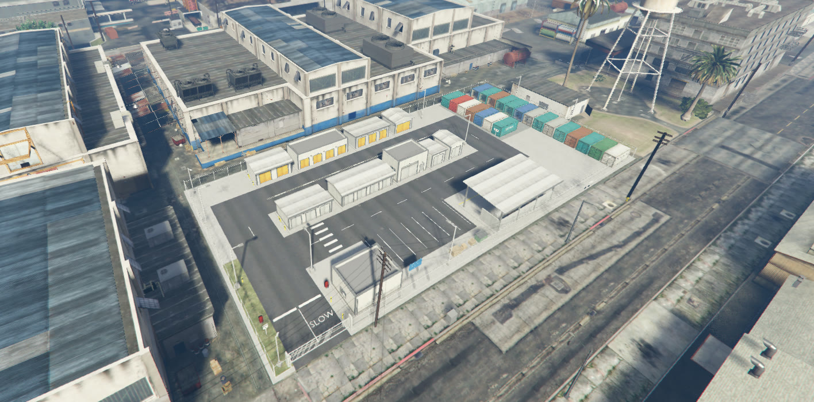

# Assets Labs Storage

Self-storage units, shipping containers and a trade counter for FiveM, built into three locations of the GTA V map: **Paleto Bay**, **Sandy Shores** and **Cypress Flats**.



Rent a unit or a container, keep your things inside and see them on display. The resource ships the three map lots, the rental script and the interface together.



## Features

- **159 units and 39 containers** across the three sites.
- Rent by days with a 4-digit PIN, plus temporary access for friends.
- **Immersive storage**: each unit has its own stash and its own furniture, bought in the panel and placed by the player: shelving, gun racks, weapon cases, lockers, tool chests, safes, fridges and more.
- **What you store is on display**: items kept in furniture appear as real props on the shelves, and loose items are dropped as their own world models, with their metadata kept when picked back up.
- **Upgrades** that expand the stash of a unit.
- **Animated doors**: roller shutters roll up, container doors swing open, the entrance gate slides and the road barriers lift for vehicles.
- **Break-ins**: lockpicking with skill items, police search with a warrant, and dispatch alerts to the owner and the police.
- **Unpaid units** go to a 48-hour auction with everything inside, at a price that drops over time.
- **Trade counter** to sell materials and buy tools.
- **A hidden tunnel on every site**, running from a container to a unit inside the facility.
- **Three customised lots**: the original buildings, fences and props on each lot are removed cleanly, the ground blends into the game terrain and the original LODs are kept intact.

| Paleto Bay | Sandy Shores | Cypress Flats |
|---|---|---|
|  |  |  |

## Requirements

| | |
|---|---|
| Libraries | [ox_lib](https://github.com/overextended/ox_lib/releases), [oxmysql](https://github.com/overextended/oxmysql/releases) |
| Frameworks | QBCore, Qbox, ESX (detected automatically) |
| Inventories | ox_inventory, qb-inventory (1.x and 2.x), ps-inventory, lj-inventory |
| Targets | ox_target, qb-target |

## Installation

1. Download the repository (green **Code** button, **Download ZIP**) or clone it. Put the folder in your resources as `aslab-storage`: the ZIP extracts as `aslab-storage-main`, so rename it.
2. Start the resource after ox_lib, oxmysql, your framework, inventory and target:
   ```
   ensure aslab-storage
   ```
3. The database tables (`ssf_storage_rentals`, `ssf_storage_meta`, `ssf_storage_placed`) are created on first start. No SQL file is needed.
4. Spanish interface: add `setr ox:locale "es"` to `server.cfg`. English is the default.

The Lua scripts ship encoded, so the source cannot be read; they are decoded in memory when the resource starts. `config.lua` stays plain so you can edit it, and the map files and the interface are plain files too.

### Map conflicts

Each facility replaces part of the base map: the buildings and props that stood on the lot, its ground collision and occluders, and the LOD data around it. Another map resource that edits the same game files will conflict with this one, and only one of them will win. Check that you do not run a second Paleto Bay, Sandy Shores or Cypress Flats map that touches the same spots.

## Configuration

Everything lives in `config.lua`:

| Section | What it controls |
|---|---|
| `Config.Framework`, `Config.Inventory`, `Config.Target` | Manual override; `auto` detects the resource |
| `Config.Sizes` | Price, slots and weight for each unit size |
| `Config.RentDays`, `Config.MaxPrepaidDays`, `Config.GraceDays`, `Config.MaxRentalsPerPlayer` | Rental lifecycle |
| `Config.PoliceJobs`, `Config.PoliceSearchTime` | Police search |
| `Config.Lockpick`, `Config.Dispatch` | Break-ins and alerts |
| `Config.Sell`, `Config.Buy`, `Config.MaxTradeAmount` | Trade counter |
| `Config.Upgrades`, `Config.Furniture`, `Config.FurnitureLimit`, `Config.FurnitureRefund` | Upgrades and furniture |
| `Config.ItemProps`, `Config.Display`, `Config.LooseItemsLimit` | Items shown in the world |
| `Config.Sale` | Auction duration and price curve |
| `Config.AccessMinutes` | Time a visitor keeps access after opening with a code |
| `Config.Doors`, `Config.Barriers` | Shutters, doors, gate and barriers |
| `Config.Zone`, `Config.Blip` | Interaction zone and map blip |

## Commands

| Command | Who | Effect |
|---|---|---|
| `ssf_reset` | ACE `group.admin`, or server console | Wipes every rental and frees all units |

## The sites

| Site | Lot |
|---|---|
| Paleto Bay | The old construction lot, by the coast road |
| Sandy Shores | The motel lot, on the main road |
| Cypress Flats | The dock lot, next to the warehouses and the water tower |

Each site has its own reception, trade counter and container yard, and its own hidden tunnel.

## License

Free to use on any number of your own servers, including monetised ones. Reselling or redistributing the resource is not allowed. See [LICENSE](LICENSE).

## Credits

- Built by Assets Labs.
- Map data, models and textures come from GTA V, handled with CodeWalker and Sollumz.
- The Nunito font (SIL Open Font License) ships with the interface.
